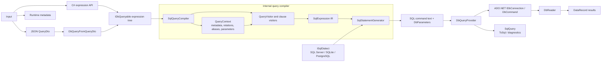

# dynamic-sql Technical Guide

## Architecture

The library is a metadata-driven query compiler and lightweight ADO.NET
materializer. Its public API is deliberately small; query compilation,
intermediate representation (IR), SQL rendering, and row mapping remain
internal implementation details.



[Open the interactive SVG diagram](artifacts/query-architecture.svg) (mouse
wheel to zoom, drag to pan).

### Pipeline responsibilities

1. **Input** accepts C# expression trees over `IRecordParameter` and
   `IDbQueryable`, JSON `QueryDto` values, and runtime metadata
   (`Entity`, `Field`, and `Relation`).
2. **Process the interface input** uses public query extensions to build a
   normal expression tree. JSON definitions are converted into the same
   expression surface by `DbQueryFromQueryDto`.
3. **Visit and build the IR** creates a dialect-independent `SqlExpression`
   tree. `SqlQueryCompiler` runs `QueryVisitor` and its clause visitors;
   `QueryContext` resolves metadata and relations, assigns aliases, applies
   archive filters, and collects parameters.
4. **Render the SQL statement** passes the resulting IR to
   `SqlStatementGenerator`. `ISqlDialect` owns quoting, table rendering,
   concatenation, booleans, and paging.
5. **Read from the database and return to the client** is handled by
   `DbQueryProvider` and `DbReader`. The provider creates synchronous or
   asynchronous ADO.NET commands, while the reader maps columns and aliases
   into `DataRecord` values.
6. **Return result data and utilities** exposes records through `ToList`,
   `FirstOrDefault`, aggregates, and async extensions. `ToSql` returns a
   `SqlQuery` containing diagnostic SQL and parameter values; it does not
   replace parameterized execution.

The visitors never own a dialect. They create an intermediate representation
that can be rendered for SQL Server, SQLite, PostgreSQL, or another dialect.

### JSON `QueryDto` compilation path

`QueryDto` is the JSON/API transport model, not the compiler IR. Its path uses
the same expression visitors and SQL generator as the C# query API:

```text
QueryDto
    -> DbQueryFromQueryDto.BuildQueryable
    -> IDbQueryable expression tree
    -> SqlQueryCompiler
    -> QueryVisitor and clause visitors
    -> TableExpression / SqlExpression IR
    -> SqlStatementGenerator(ISqlDialect)
    -> SQL command text + DbParameters
```

`DbQueryFromQueryDto` maps DTO fields, filters, sorting, and paging onto the
normal query API. It does not create SQL or bypass the visitors. The compiler
then translates the resulting expression tree to IR before SQL rendering.

## Projects

```text
src/Namh.Data.DynamicSql
    Public query API, context, dialects, provider contracts, and result types

src/Namh.Data.DynamicSql/Internal
    QueryContext, visitors, SqlExpression IR, SqlQueryCompiler,
    SqlStatementGenerator, ADO.NET execution, and result mapping

src/Namh.Data.DynamicSql.Model
    Entity, Field, Relation, QueryDto, and JSON filter models

src/Namh.Data.DynamicSql.Test
    NUnit tests, metadata fixtures, provider tests, and SQL diagnostics tests

src/Namh.Data.DynamicSql.ConsoleTest
    Manual usage sample
```

## Important public classes

### `DynamicSqlContext`

Creates query providers from an `IDbConnection`, metadata provider, and
optional dialect:

```csharp
var db = new DynamicSqlContext(connection, metadata, dialect);
```

It exposes:

- `Query(entityName)`
- `Query(entityName, includeArchive)`
- `QueryJson(json)`

The context owns the supplied connection.

### `IRecordParameter`

The expression-tree surface for dynamic field access:

```csharp
query.Where(record => record["Name"] == "Alice");
```

It provides:

- Indexer field access
- `DbColumn`
- `RawSql`
- Related query access through `Query`

`DataValue` overloads make comparisons and expressions possible without
materializing a CLR entity.

### `QueryDto`

The JSON transport model contains entity, projection fields, filters, sorting,
and paging. Each `ProjectionDto` carries a structured field expression and
optional alias, and is translated into the same query pipeline used by C#
expressions.

Filters are represented recursively: `FilterItemDto` carries `Left` and optional
`Right` `IFieldDto` expressions plus an operation, while `FilterDto` combines
child filters with `And` or `Or`. Field expressions use the same tagged JSON
format as projection fields; constants are tagged value expressions. Legacy
`field`/`value` filter JSON and string field names remain readable.

`QueryDtoParser` is responsible for:

- JSON property parsing
- Projection fields and aliases
- Bracketed field paths
- Filter precedence
- Typed literals
- Sort directions

JSON values are marked as parameterized before expression translation.

## Query provider flow

### `DbQueryProvider`

`DbQueryProvider` connects the public query object to translation and execution.
It delegates compilation to the internal `SqlQueryCompiler`, then:

1. Creates ADO.NET parameters from the compiled parameter values.
2. Executes synchronous or asynchronous commands.
3. Uses `DbReader` to materialize `DataRecord` instances.

`GetQuery` is used for diagnostics and returns `SqlQuery`.

### `SqlQueryCompiler`

`SqlQueryCompiler` is the internal boundary between translation and execution. It
accepts an expression tree, creates a dialect-independent IR through the
visitors, renders it using the selected dialect, and returns command text,
parameters, and projection metadata. It has no database connection and does
not execute queries.

### `QueryContext`

`QueryContext` owns translation state:

- Metadata lookup
- Table aliases
- Relationship joins
- SQL parameters
- Archive filters
- Field-path resolution
- Function definitions and recursive function-argument translation

It must remain dialect-independent. Dialect decisions belong in
`SqlStatementGenerator` and `ISqlDialect`.

### Visitors

Important visitors include:

- `QueryVisitor`: visits the overall query expression.
- `ClauseVisitor`: handles `Where`, `Select`, ordering, paging, `Count`, and
  `Any`.
- `WhereVisitor`: translates predicates and parameter values.
- `SelectVisitor`: translates projections and `DataRecord` aliases.
- `RecordParameterVisitor`: translates field, raw SQL, database-column, and
  related-query access.
- `LambdaVisitor`: common lambda traversal behavior.

Visitors produce IR nodes rather than SQL strings.

## SQL expression IR

The IR is in `Internal/Compilation/Expressions`. Important types include:

- `SqlExpression`: base type for dialect-independent SQL nodes.
- `TableExpression`: query scope, joins, filters, projections, ordering, and
  paging.
- `FieldExpression`: metadata-backed field reference.
- `ValueExpression`: literal or parameter placeholder.
- `BinarySqlExpression`: binary operations.
- `PredicateExpression`: predicates such as `LIKE`.
- `CompareSqlExpression`: raw comparison operators.
- `ProjectionExpression`: aliased projection.
- `FunctionSqlExpression`: metadata-defined function call with expression,
  SQL-token, or logical-type arguments.
- `AggregateExpression`: aggregate metadata and subqueries.
- `SubqueryExpression`: nested query.
- `AnyExpression`: `EXISTS` query.
- `JoinExpression`: relationship join and join conditions.

The IR must not depend on `ISqlDialect`.

### Supported input and output types

| Boundary | Supported types | Purpose |
| --- | --- | --- |
| Query root | `IDbQueryable` | Deferred query and expression-tree root |
| C# field input | `IRecordParameter` / `DataValue` | Dynamic fields, parameters, trusted raw SQL, and related queries |
| JSON input | `QueryDto`, `FilterDto`, `SortDto` | Serializable query transport, including page and page size |
| Metadata | `IMetaProvider`, `Entity`, `Field`, `Relation`, `FunctionDefinition`, `SqlTypeDefinition` | Runtime schema, relationships, function signatures, and logical SQL types |
| Compiler IR | Internal `SqlExpression` hierarchy | Provider-independent query representation |
| SQL target | `ISqlDialect` | SQL Server, SQLite, PostgreSQL, or a custom provider |
| Diagnostic output | `SqlQuery`, `SqlQueryParameter` | SQL text plus parameter values for `ToSql` |
| Client result | `DataRecord`, `List<DataRecord>` | Case-insensitive dynamic row values and async materialization |

`DataValue` is an expression-building token, not a database value object. Its
operators are consumed while translating expression trees; query values are
parameterized unless the caller explicitly uses a trusted raw-SQL escape hatch.

## `SqlStatementGenerator`

`SqlStatementGenerator` consumes a `TableExpression` and an `ISqlDialect`. It renders:

- `SELECT`
- `FROM`
- joins
- `WHERE`
- `ORDER BY`
- provider-specific paging
- field and identifier quoting
- aggregate subqueries
- dialect-keyed function templates from `IMetaProvider`
- parameters

It also preserves readable diagnostics formatting. SQL execution uses the
generated command text and parameter collection directly; it does not use the
diagnostic formatter.

Function definitions select templates using the dialect's stable string
identifier. Common functions and SQL types may define a generic fallback;
provider-specific templates override it by identifier. Templates are trusted metadata; query expression values remain
parameterized, and logical type arguments are mapped through metadata rather
than copied from query text. Applications can enumerate definitions with
`IMetaProvider.GetFunctions()` and `GetSqlTypes()` when building a function
selection UI. Custom `ISqlDialect` implementations provide their own identifier
to render metadata-defined functions.

## `ISqlDialect`

The dialect abstraction owns provider differences:

- Identifier quoting
- Boolean rendering
- String concatenation
- `TOP`, `LIMIT`, or `OFFSET/FETCH`
- Schema/table rendering

Built-in implementations:

- `SqlServerDialect`
- `SqliteDialect`
- `PostgresDialect`

When adding a provider, implement `ISqlDialect` and add SQL-generation tests
for identifiers, booleans, concatenation, and paging.

## Diagnostics formatting

`SqlFormatter` formats diagnostic SQL only. It does not participate in normal
execution.

For SQL Server diagnostics, `DbQueryProvider.GetQuery` prepends typed
declarations:

```sql
DECLARE @p0 nvarchar(4000) = 'Dav%',
	@p1 nvarchar(4000) = 'Alice',
	@p2 int = 12;
```

The actual command still uses `@p0`, `@p1`, and `@p2`, while
`SqlQuery.Parameters` retains the structured values.

## Metadata resolution

`QueryContext.ParseFieldPath` resolves paths such as:

```text
Name
Manager.Name
Members.TotalMembers
```

It follows relations, creates aliases, applies archive filters, and resolves
aggregate fields. Missing entities, fields, and relations produce dedicated
metadata exceptions:

- `EntityNotFoundException`
- `FieldNotFoundException`
- `RelationNotFoundException`

## Adding a query feature

Follow this sequence:

1. Add or reuse a public query method.
2. Add the corresponding visitor translation.
3. Represent the result with a dialect-independent IR node.
4. Add rendering in `SqlStatementGenerator`.
5. Add provider-independent and provider-specific tests.
6. Add diagnostics assertions when output shape matters.
7. Update [MANUAL.md](MANUAL.md) for user-facing behavior.

Do not build provider-specific SQL inside visitors or `QueryContext`.

## Security boundaries

Normal values must flow through `QueryContext.AddDbParameter`. Do not inline
untrusted values into raw SQL. `RawSql`, `RawCompare`, and raw metadata
expressions are trusted escape hatches and must not receive user-controlled
text without validation.

## Testing

Run the complete suite:

```powershell
dotnet test .\src\Namh.Data.DynamicSql.Test\Namh.Data.DynamicSql.Test.csproj
```

The test project targets .NET 8, .NET 9, and .NET 10. Tests cover metadata
resolution, expression translation, JSON definitions, SQL diagnostics, async
execution, SQLite behavior, and SQL Server behavior.
